# tinyml-fpga

**Run int8 TensorFlow Lite models on any FPGA. Bit-exact with LiteRT. Drive it from a PC or a $1 microcontroller.**

```python
import tinyml_fpga
m = tinyml_fpga.load("motion.tmf", backend="uart:COM5")     # or "cpu", "sim", HwEngine(your_bus)
label, p = m.classify(window)                                # conv + dense layers run in the fabric
```

Plain vendor-neutral Verilog (no primitives, no IP cores), a ~5 KB-per-model binary format, and one tiny Python runtime that runs on **CPython and MicroPython**. Proven on real hardware: a live IMU motion classifier running its conv and dense layers on a 3.9K-LE FPGA at 25 MHz.

[Configurator](https://ayush130305.github.io/TinyML-fpga/)

> Install name `tinyml-fpga`, import name `tinyml_fpga` (Python modules can't contain a hyphen; same as `scikit-learn` / `sklearn`).

## Why

| | |
|---|---|
| **Bit-exact** | every int8 tensor of every test model matches LiteRT, op by op (TFLite's single-rounding requantisation, reproduced in RTL) |
| **Any FPGA, any link** | the engine sits on a 16-bit-address byte bus. UART, SPI, I2C and AXI4-Lite bridges are included; any other link = one 2-method class |
| **Runs on a microcontroller** | the runtime needs no numpy; copy 5 files to a MicroPython board and go |
| **Self-describing hardware** | the engine reports its RAM sizes; the runtime plans weight residency, channel chunks and batching for whatever build it finds, and falls back to software for layers that can never fit |
| **Scalable** | 1 to 8 MAC lanes, pipelined requantiser, command queue, on-chip window generator, layer fusion, 4-bit and codebook weights; every feature is a parameter that costs nothing when off |
| **Small** | ~1,800 logic elements, 13 small block RAMs, 1 multiplier (default build) |
| **Tested** | 220+ pytest tests, Verilog testbenches (engine, UART, SPI, I2C, AXI4-Lite paths), MicroPython run, LiteRT cross-check |

## How it works

<p align="center"></p>

Every accelerated layer is reduced to one primitive, a batched int8 dot product with TFLite requantisation:

`y = clamp( requant( bias + Σ (x + in_off) · w ) + out_zp )`

Conv (via im2col, or the engine's own window generator), depthwise conv and fully-connected all become that. Pooling, reshape, softmax and quantize/dequantize stay on the host.

## Install

```bash
pip install git+https://github.com/ayush130305/TinyML-fpga.git      # just use it
# or work from source:
git clone https://github.com/ayush130305/TinyML-fpga.git && cd TinyML-fpga
pip install -e ".[dev,uart]"        # runtime + converter + LiteRT checker + pytest + pyserial
pip install -e ".[board]"           # + mpremote, to copy the runtime to a MicroPython board
pip install -e ".[train]"           # + TensorFlow, only for the example training scripts
```

The board-side runtime itself needs nothing.

## Use it in 4 steps

**1. Train and export a fully int8 model.** `optimizations=[DEFAULT]`, a `representative_dataset`, `TFLITE_BUILTINS_INT8`, int8 input and output. See `examples/digits/train.py`.

**2. Convert and verify (PC).**
```bash
python -m tinyml_fpga convert model.tflite        # writes model.tmf, checks it bit-exact vs LiteRT
python -m tinyml_fpga info model.tmf              # which layers run on the engine, which on the host
```

**3. Put the engine on your FPGA.** Add `rtl/*.v` to your project, top = `tinyml_uart_top` (or `tinyml_spi_top`, `tinyml_i2c_top`, `tinyml_axil_top`), set the feature and RAM-size parameters (and `CLK_HZ`, `BAUD` for UART), connect the top's ports (and optionally `status[2:0]` LEDs) in your pin file and add a clock constraint.

**4. Run.**
```python
m = tinyml_fpga.load("model.tmf", backend="uart:COM5", baud=921600)      # from a PC
m.summary()                                                              # per-layer placement
idx, p = m.classify(x)                                                   # float input, quantised for you
y = m.invoke(xq)                                                         # int8 in, int8 out, no float
```

From a MicroPython board wired to the FPGA:
```python
from tinyml_fpga.buses import McuUartBus
m = tinyml_fpga.load("model.tmf", backend=tinyml_fpga.HwEngine(McuUartBus(921600, tx=8, rx=9)))
```

## Backends

| `backend=` | runs on | use |
|---|---|---|
| `"cpu"` | the host, pure Python | reference, or no FPGA at all |
| `"sim"` | a register-accurate Python model of the engine | test the whole driver path with no hardware |
| `"uart:PORT"` | FPGA behind `rtl/tinyml_uart_top.v`, from a PC | any board with a USB-UART |
| `"spi:BUS.DEV"`, `"i2c:BUS:ADDR"`, `"axi:BASE"` | FPGA behind the SPI / I2C / AXI4-Lite top, from Linux | spidev, smbus2, `/dev/mem` |
| `HwEngine(bus)` | FPGA behind your own link | `McuUartBus`, `McuSpiBus`, `McuI2cBus` (MicroPython), or any class with `write_block(addr, buf)` and `read_block(addr, n)` |

All backends give identical, bit-exact results.

## Command reference

| Command | What it does |
|---|---|
| `python -m tinyml_fpga convert M.tflite [OUT.tmf] [--no-check]` | convert, then verify against LiteRT |
| `python -m tinyml_fpga info M.tmf [--sizes W_AW X_AW Y_AW P_AW]` | layer table and plan for an engine build (default 12 10 8 10) |
| `python -m tinyml_fpga check M.tflite [--n 50]` | bit-exact comparison with LiteRT on N inputs |
| `python -m tinyml_fpga deploy [M.tmf ...] [--port COMx]` | copy the runtime and models to a MicroPython board (mpremote) |
| `python -m tinyml_fpga convert M.tflite --int4 auto` / `--codebook auto` | 4-bit or codebook weights for engines with `HAS_W4` / `HAS_CB` |
| `python -m tinyml_fpga configure --budget 8k [--suggest] [--features ...] [--out pkg.zip]` | check features against a LUT budget, write an RTL package |
| `pytest` | full test suite (RTL and MicroPython tests skip if `iverilog` / `micropython` are missing) |
| `bash rtl/sim/run_sim.sh [engine\|uart\|bus]` | Icarus Verilog testbenches: engine alone, the UART path, or the SPI / I2C / AXI4-Lite paths (`BUS=1..3`) |

## RTL parameters (the `rtl/tinyml_*_top.v` tops)

| Parameter | Default | Meaning |
|---|---|---|
| `LANES` / `RQ_MODE` | 1 / 0 | output channels computed at once (1, 2, 4, 8) / serial or pipelined requantiser |
| `HAS_QUEUE` `HAS_PERF` `HAS_WIN` `HAS_FUSE` `HAS_W4` `HAS_CB` | 0 | command queue, counters, window generator, layer fusion, 4-bit weights, codebook weights (see [features](docs/features.md)) |
| `CLK_HZ` | 100000000 | your fabric clock in Hz (sets the UART divider; UART top only) |
| `BAUD` | 921600 | UART rate; pass the same value to the host (UART top only) |
| `W_AW` | 12 | weight RAM = 2^W_AW bytes (max 15) |
| `X_AW` / `Y_AW` | 10 / 8 | input / output RAM address bits (max 12) |
| `P_AW` | 10 | parameter RAM, 16 B per output channel (max 12) |
| `D_AW` | 9 | descriptor RAM, 64 B per descriptor (with `HAS_QUEUE`) |

Bigger RAMs mean fewer weight transfers. Too-small RAMs still work, only slower: weights stream, layers split into channel chunks, and anything that cannot fit runs in software.

## Supported layers

| TFLite op | runs on |
|---|---|
| CONV_2D (stride, dilation, SAME / VALID, fused RELU / RELU6), Conv1D | engine |
| DEPTHWISE_CONV_2D (any depth multiplier) | engine |
| FULLY_CONNECTED | engine |
| MAX_POOL_2D, AVERAGE_POOL_2D | host, bit-exact |
| RESHAPE, SQUEEZE, EXPAND_DIMS, RELU, RELU6 | host, bit-exact |
| SOFTMAX | host, float (argmax always matches) |
| QUANTIZE / DEQUANTIZE at the model edges | host |

Anything else (ADD / residuals, MEAN, CONCATENATION, ...) is rejected by the converter with a clear message. Single-subgraph models only.

## Examples

| | |
|---|---|
| `examples/digits/` | 8×8 handwritten digits. `train.py` → `digits.tmf`; `run_pc.py [cpu\|sim\|uart:COM5]` |
| `examples/imu_motion/` | live motion classifier (idle / shake / circle) from a BMI323 IMU: `record.py` collects data on the board, `train.py` trains on the PC (with rotation augmentation), `main.py` classifies live with the layers on the FPGA |

## Performance and size

Engine cost per output: `K + 54 + ts/8 + ts%8` clocks with requantisation (ts = 31 − shift, typically 35–45), or `K + 20` raw. About 100 clocks for a 3×3 conv output.

Default build on a small FPGA at 25 MHz: ~1,800 LEs, 878 FFs, 13 block RAMs, 1 multiplier, timing met. For tiny models the link and host-side patch gathering dominate (a digit takes ~450 ms from a microcontroller over UART); the FPGA pays off as layers get wider.

## Verified

| Check | Result |
|---|---|
| runtime vs LiteRT, every intermediate tensor, 5 models, natural and random inputs | bit-exact (softmax within 1 step) |
| requantiser vs exact rational arithmetic, 20,000 cases | exact |
| RTL engine vs Python model (`tb_engine.v`): depthwise, raw int32, extreme shifts, all error cases | every output byte, status and cycle count match |
| UART path end to end (`tb_uart_top.v`) | every byte matches |
| MicroPython unix port | identical to CPython |
| small engine builds (streamed weights, channel chunks, software fallback) | identical to the software engine |
| real FPGA + microcontroller | digits 9/10 identical to the PC; live BMI323 motion classification works |

## Layout

```
tinyml-fpga/
├── README.md
├── firmware/
│   ├── tinyml_fpga/     runtime (PC + MicroPython): model, kernels, engine, buses; PC-only: converter, check, CLI
│   └── tests/           pytest suite, test models, MicroPython runner
├── rtl/
│   ├── tinyml_{uart,spi,i2c,axil}_top.v   ready-to-use tops: bus bridge + engine
│   ├── tmf_engine.v  tmf_lane.v  tmf_rq.v  tmf_requant*.v  tmf_ram.v
│   ├── uart_bus.v  spi_bus.v  i2c_bus.v  axil_bus.v  uart_rx.v  uart_tx.v
│   └── sim/             testbenches, vector generators, run_sim.sh
├── configurator/        cost model + generator shared by the CLI and the web page
├── tools/               Yosys measurements, benchmarks, cost-model fit
├── docs/                architecture.md, features.md, adding_a_board.md, model_format.md, index.html
└── examples/            digits/, imu_motion/
```

## Docs

[architecture](docs/architecture.md) · [features by version](docs/features.md) · [adding a board or link](docs/adding_a_board.md) · [model format (.tmf)](docs/model_format.md)

## Roadmap

Sensor FIFO streaming for live demos.

## License

Apache-2.0, see [LICENSE](LICENSE). Copyright 2026 Ayush Jain.
